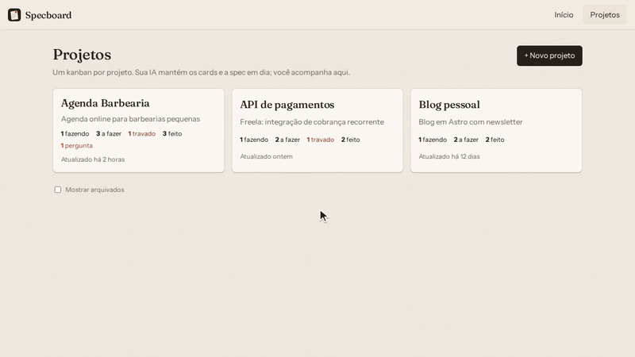

<p align="center"></p>

<h1 align="center">Specboard</h1>

<p align="center">
  <a href="https://github.com/lucasararipedev/specboard/stargazers"></a>
  <a href="LICENSE"></a>
</p>

<p align="center"><b>Open source e gratuito.</b> Se o Specboard te ajudar, deixe uma ⭐ no repositório: ajuda outros devs a encontrarem o projeto.</p>

<p align="center">
  
  <br><sub>Você só acompanha: quem cadastra e mantém os cards é a sua IA.</sub>
</p>

**Kanban spec-first que a sua IA mantém por você.** Sobe com um `docker compose up`, você cola um prompt na
sua IA (Claude, ChatGPT, Gemini, Cursor, Codex…, o mesmo texto para todas) e a partir daí ela registra
tarefas, move status, guarda decisões na spec e te lembra das prioridades no começo de cada sessão, sempre com
o link do card. Funciona como memória de longo prazo da IA, entre sessões e entre projetos.

Feito para devs que querem ser mais organizados e não depender de PO desorganizado para saber o que fazer.

```
você: "amanhã preciso integrar o Stripe, e lembra que o login com Google tá quebrado"
IA:   cria 2 cards (P1 bug no todo, integração no backlog), te manda os links
...
próxima sessão
IA:   "Você tem o bug do login em andamento há 3 dias e o Stripe é o próximo. Seguimos no login?"
```

## Como funciona

- **Um kanban por projeto**: `backlog → todo → doing → blocked → done`, com prioridade, prazo e etiquetas.
- **Filtro por etiquetas**: tipo, área e versão são etiquetas (`bug`, `front`, `v0.2`…). Escolha uma ou várias e
  o board mostra só os cards que têm todas: mesmo com milhares de cards, você vê só o que entra na próxima entrega.
- **Spec first**: cada projeto tem uma spec em Markdown que é a fonte da verdade. Decisões entram nela antes
  de virar card, e cada card aponta a seção que implementa.
- **Perguntas**: em vez de supor, a IA te pergunta o que só você sabe (com opções para clicar). Você responde
  no board e ela usa a resposta na spec e nos cards. Todo projeto novo já vem com 5 perguntas iniciais.
- **Atividade**: tudo que muda fica registrado, com quem mudou (você ou a IA).
- **Painel Agora**: cada chat ligado ao board (`/board`) aparece em `/projetos` com o que está fazendo naquele
  momento. Deixe aberto numa tela e veja o que cada agente está fazendo.
- **Briefing**: um resumo por projeto com lembretes prontos para a IA puxar com você (card parado há dias, P0
  esquecido no backlog, prazo vencido, nada em andamento…).
- **Feito para IA**: MCP em `/mcp`, plugin para o Claude Code, manual em `/llms.txt`, prompt padrão, respostas
  com link, OpenAPI em `/docs`.
- **Perfil**: seu nome e foto no histórico e no topo; a IA passa a te chamar pelo nome.
- **Sem IA dentro, sem conta, sem chave**: a IA é a que você já usa. Os dados ficam num SQLite na sua máquina.

## Começando

Precisa só de Docker.

```bash
git clone https://github.com/lucasararipedev/specboard
cd specboard
docker compose up -d          # ou: make up (já mostra o link no fim)
```

Esqueceu o endereço? `make link` mostra o link e avisa se o app está fora do ar.

1. Abra http://localhost:8787.
2. Na página inicial, clique em **Copiar prompt** (ou selecione o texto e copie) e cole na sua IA. É um texto
   só para qualquer IA, o mesmo de [PROMPT.md](PROMPT.md). Ela lê o manual, salva as regras na memória dela e
   começa a cuidar do board.
3. Peça: *"crie um projeto no Specboard pro que estou fazendo, escreva uma spec curta e registre os próximos
   passos"*.
4. Acompanhe em **Projetos** (http://localhost:8787/projetos). A tela se atualiza sozinha enquanto a IA trabalha.

**Usa Claude Code?** No lugar do passo 2, instale o plugin (veja [Plugin do Claude Code](#plugin-do-claude-code)).
Cursor e outras ferramentas com MCP usam `http://localhost:8787/mcp`.

IA no navegador (ChatGPT, claude.ai) não alcança o `localhost`; veja as saídas em
[docs/conectar-ia.md](docs/conectar-ia.md).

## Plugin do Claude Code

Com o Specboard no ar, cole no terminal e abra um chat novo:

```bash
curl -fsSL http://localhost:8787/install/claude-code.sh | sh       # Linux, macOS, WSL, Git Bash
irm http://localhost:8787/install/claude-code.ps1 | iex            # Windows (PowerShell)
```

O instalador acha o Claude Code no terminal ou dentro da extensão do VS Code e do Cursor (que não põe o comando
`claude` no terminal). Usa VS Code com WSL? Rode o primeiro no terminal do WSL. Se ele não achar o Claude Code,
diz o que fazer. Quem já tem o `claude` no terminal pode rodar direto
`claude plugin install specboard --marketplace lucasararipedev/specboard`.

| Comando | O que faz |
|---|---|
| `/board` | Liga este chat ao board, compara a conversa com o board, registra o que faltou (cards, status, decisões, perguntas, etiquetas) e responde em 3 linhas: **Registrei**, **Esquecendo**, **Agora**. |
| `/board off` | Desliga este chat: ele sai do painel Agora. |

Sem comando nenhum:

- chat aberto na pasta de um projeto (campo `repo`) já começa ligado, mostra "Specboard ativo neste chat" e a IA
  recebe o briefing; em outras pastas, fica desligado até o `/board`;
- a IA usa o MCP para criar e mover cards, anotar decisões e perguntar o que só você sabe;
- cada chat ligado aparece no painel **Agora** em `/projetos`, com o que está fazendo, e sai ao fechar.

Endereço ou token diferentes: defina `SPECBOARD_URL` e `SPECBOARD_TOKEN` no ambiente antes de abrir o Claude Code.
Atualizar e remover: `claude plugin update specboard@specboard` e `claude plugin uninstall specboard@specboard`
(sem o `claude` no terminal, use o caminho que o instalador mostrou). Detalhes em
[integrations/claude-code](integrations/claude-code/README.md).

## Configuração

Tudo opcional. Para mudar, `cp .env.example .env`, edite e rode `docker compose up -d` de novo.

| Variável | Padrão | Para quê |
|---|---|---|
| `SPECBOARD_PORT` | `8787` | Porta na sua máquina |
| `SPECBOARD_PUBLIC_URL` | `http://localhost:8787` | URL que a IA usa e manda nos links (ajuste junto com a porta) |
| `SPECBOARD_BIND` | `127.0.0.1` | Interface de rede; `0.0.0.0` abre na rede local |
| `SPECBOARD_TOKEN` | vazio | Se definido, a API exige `Authorization: Bearer <token>` |
| `SPECBOARD_STALE_DAYS` | `3` | Dias sem atualização para um card em andamento virar lembrete |
| `SPECBOARD_ALLOWED_HOSTS` | vazio | Outros nomes ou IPs aceitos além de `localhost` e do host da `SPECBOARD_PUBLIC_URL` (ex.: `192.168.0.10`) |

Por padrão só a sua máquina acessa. Se abrir na rede ou num túnel, **defina um token** (`openssl rand -hex 24`) e
acesse pelo endereço da `SPECBOARD_PUBLIC_URL` (ou liste o IP em `SPECBOARD_ALLOWED_HOSTS`): outros nomes são
recusados.

## Privacidade, LGPD e segurança

- **Nada sai da sua máquina por causa do Specboard.** Sem conta, sem telemetria, sem analytics, sem chamadas a
  serviços de terceiros: fontes, vídeo e ícones são servidos localmente. Os dados ficam num arquivo SQLite no
  volume Docker `specboard-data`.
- **Você é o controlador dos dados.** O projeto (e quem o mantém) não recebe nem armazena nada do que você
  registra.
- **O que vai para a sua IA segue as regras dela.** Cards, specs e respostas que a IA lê ou escreve passam pelo
  provedor que você escolheu (Anthropic, OpenAI, Google…), conforme a política de privacidade dele. Evite colocar
  dados pessoais de terceiros (clientes, usuários) nos cards; se precisar, trate como faria em qualquer
  ferramenta de trabalho.
- **Portabilidade e exclusão:** `GET /api/export` (ou `make backup`) exporta tudo em JSON; apagar um card ou
  projeto remove do banco, e `docker compose down -v` apaga tudo.
- **Proteções:** porta presa em `127.0.0.1`; sem CORS (um site aberto no seu navegador não consegue ler nem mudar
  os dados); hosts desconhecidos recusados (contra *DNS rebinding*); token opcional comparado em tempo
  constante e nunca incluído no prompt; Markdown sanitizado com DOMPurify; cabeçalhos de segurança e CSP na
  interface; container sem root.

Achou uma falha de segurança? Abra uma [issue](https://github.com/lucasararipedev/specboard/issues) sem detalhes
do ataque e peça um contato privado, ou use *Report a vulnerability* na aba Security do repositório.

## Dados e backup

Os dados ficam no volume Docker `specboard-data` (arquivo SQLite). Para backup:

```bash
make backup                                   # ou:
curl -s http://localhost:8787/api/export -o backup.json
```

`docker compose down` mantém os dados; `docker compose down -v` apaga.

## API

A referência para IAs é o [`/llms.txt`](http://localhost:8787/llms.txt): regras, conceitos, endpoints e exemplos
em `curl`. A referência completa (OpenAPI) está em http://localhost:8787/docs. O MCP (Streamable HTTP) fica em
`/mcp`, com as mesmas regras e ações. Resumo:

| Rota | Para quê |
|---|---|
| `GET /api/briefing` | Resumo de todos os projetos com lembretes (`?format=json`) |
| `GET/POST /api/projects`, `GET/PATCH/DELETE /api/projects/<slug>` | Projetos e spec |
| `GET/POST /api/projects/<slug>/cards`, `GET/PATCH/DELETE /api/cards/<id>` | Cards (`?label=v0.2&label=front` = com todas as etiquetas) |
| `GET /api/projects/<slug>/labels` | Etiquetas em uso, com contagem |
| `GET/POST /api/projects/<slug>/questions`, `PATCH /api/questions/<id>` | Perguntas para o usuário e respostas |
| `GET/POST /api/projects/<slug>/activity` | Histórico, notas e decisões |
| `GET /api/search?q=` | Busca de cards (para não duplicar) |
| `GET/POST /api/sessions`, `PATCH/DELETE /api/sessions/<key>` | Chats ligados ao board (painel Agora) |
| `GET/PUT /api/profile` | Nome e foto do usuário |
| `GET /api/export` | Backup em JSON |

A IA se identifica com o header `X-Actor` (ex.: `claude`), e o histórico mostra quem fez o quê.

## Desenvolvimento

```bash
make dev     # front com hot reload em http://localhost:5173, API em http://localhost:8787
make test    # pytest da API + typecheck e build do front, em containers
```

Sem `make`, os comandos estão no [Makefile](Makefile). Para rodar fora do Docker: `pip install -r
backend/requirements-dev.txt` e `uvicorn app.main:create_app --factory --port 8787 --reload` dentro de
`backend/`; `npm install && npm run dev` dentro de `frontend/`.

```
backend/          FastAPI + SQLAlchemy + SQLite (Python 3.12)
  app/
    main.py         cria a app, roda as migrações, registra rotas e o /mcp, serve o front buildado
    config.py       variáveis SPECBOARD_*
    models.py       Project, Card, Question, Activity, AgentSession, Profile
    migrations/     Alembic: toda mudança de esquema é uma migração nova
    mcp_server.py   servidor MCP (tools e o prompt board), sobre os mesmos serviços da API
    schemas.py      contratos da API (Pydantic)
    api/            rotas: projects, cards, questions, activity, sessions (e hooks), profile,
                    agent (briefing, busca, export, llms.txt, prompt)
    services/       regras de cada recurso (usadas pela API e pelo MCP), briefing (lembretes), agent_docs
                    (prompt, manual, instruções do MCP e roteiro do /board), serialize (respostas com url)
  tests/          pytest
frontend/         Vue 3 + Vite + TypeScript + Vue Router
  src/views/        Início (landing com o prompt), Projetos (com o painel Agora), Board (kanban com filtro por etiquetas,
                    spec, perguntas, atividade), Perfil
  src/components/   CardModal, LabelFilter, AgentsNow, QuestionsPanel, UserAvatar, CopyBlock, MarkdownView
integrations/claude-code/  plugin do Claude Code (MCP, /board, hooks); o marketplace fica em .claude-plugin/
docs/             conectar-ia.md (o prompt, IAs no navegador, dúvidas), demo.gif (README)
scripts/demo-video/  grava o vídeo de demonstração da página inicial
spec.md           a spec deste projeto: problema, escopo da v1, roadmap, decisões
PROMPT.md         o prompt padrão (um teste garante que bate com o servido pela API)
Dockerfile        imagem única: build do front + API
```

Contribuindo com ajuda de IA? O [AGENTS.md](AGENTS.md) tem as convenções do repo.

## Roadmap

No radar: integração com GitHub, lembretes por e-mail/Telegram, subtarefas e import do backup e de outras
ferramentas. Detalhes em [spec.md](spec.md), seção 7.

## Apoie o projeto

O Specboard é open source e vai continuar gratuito. Se ele te ajudou:

- **Deixe uma estrela** em [github.com/lucasararipedev/specboard](https://github.com/lucasararipedev/specboard):
  é o que faz o projeto aparecer para outros devs.
- Abra uma [issue](https://github.com/lucasararipedev/specboard/issues) com bug, ideia ou o jeito como você usa.
- Pull requests são bem-vindos; as convenções estão no [AGENTS.md](AGENTS.md).

## Licença

[AGPL-3.0](LICENSE). Use, mude e hospede à vontade; se oferecer uma versão modificada como serviço para
outras pessoas, publique o código dela sob a mesma licença.
